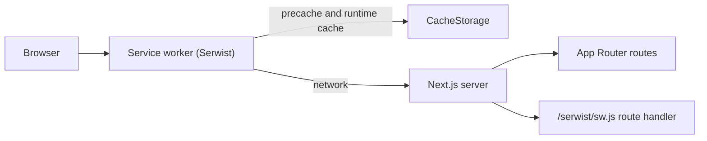
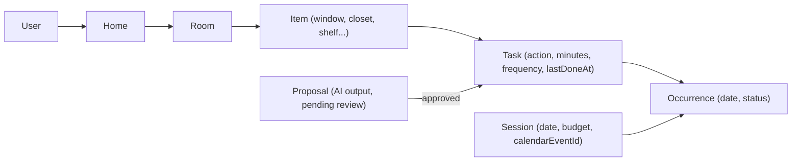
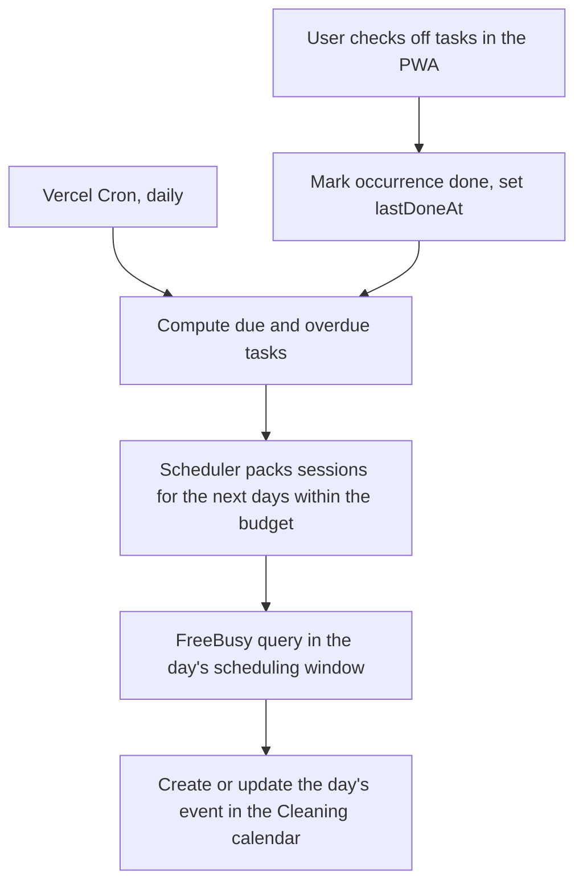

# Architecture

## Overview

A single Next.js 16 App Router application, rendered with Cache Components and Partial Prefetching, installable as a PWA. It plans household cleaning: AI proposes tasks, a deterministic scheduler packs them into daily sessions, and the sessions are synced to Google Calendar.

## Rendering

- **Server Components by default.** Client Components only where interactivity is needed.
- **Cache Components** (`cacheComponents: true`): static shell + dynamic holes behind `<Suspense>`. Use `"use cache"` for cacheable data. Route segment config (`dynamic`, `revalidate`) is not allowed.
- **Partial Prefetching**: `<Link>` prefetches the static shell of a route so it can render instantly, even offline.

## PWA and offline

| Concern                          | Where                                                                                   |
| -------------------------------- | --------------------------------------------------------------------------------------- |
| Manifest                         | `src/app/manifest.ts` (served at `/manifest.webmanifest`)                               |
| Icons                            | `public/icons/`                                                                         |
| Service worker source            | `src/app/sw.ts`                                                                         |
| Service worker build and serving | `src/app/serwist/[path]/route.ts` (esbuild at request time, served at `/serwist/sw.js`) |
| Registration                     | `SerwistProvider` in `src/app/layout.tsx`                                               |
| Offline document fallback        | `src/app/~offline/page.tsx` (precached)                                                 |
| In-app connectivity state        | `experimental.useOffline` + `useOffline()` in `src/components/offline-banner.tsx`       |

There are two layers of offline behavior:

1. **Inside a running app**: Next's `useOffline` keeps failed soft navigations and Server Actions pending and retries them when the connection returns. The offline banner tells the user.
2. **Cold loads without network**: the service worker serves precached assets and runtime-cached pages; uncached documents get the `/~offline` fallback.

## UI

- Tailwind CSS v4 with CSS variables defined in `src/app/globals.css` (light and `.dark`).
- shadcn/ui components in `src/components/ui/` (Base UI primitives).
- Theme via `next-themes` (`class` strategy, system default).
- Layout shell in `src/components/app-shell.tsx`, which handles safe-area insets for standalone mode.

## Domain model

Terms are defined in the glossary in [`PRODUCT.md`](PRODUCT.md#glossary).

- Every user-owned record carries a `userId`, so sharing can be added later.
- **Due date = `lastDoneAt` + frequency.** A task's schedule moves with actual completion rather than following a fixed recurrence.
- **Priority = overdue ratio** (days past due divided by frequency), so a weekly task 3 days late outranks a monthly task 3 days late.

## Responsibilities: AI vs code

| Concern                                   | Owner                                          | Why                                      |
| ----------------------------------------- | ---------------------------------------------- | ---------------------------------------- |
| Propose tasks, minutes, frequency, splits | Gemini (structured output, Zod-validated)      | Needs world knowledge about cleaning     |
| Approve or edit proposals                 | User                                           | Trust and control                        |
| Pack tasks into daily sessions, rebalance | Deterministic scheduler (`src/lib/scheduler/`) | Predictable, testable, free, explainable |
| Place the session in a free slot          | Calendar sync via FreeBusy                     | Respects the user's real availability    |

## Daily flow

- The scheduler plans a rolling horizon (for example 7 days) and is re-run after every check-off and by the daily job, so missed work is redistributed automatically without exceeding the daily budget.
- Calendar writes are idempotent: each session stores its `calendarEventId` and is updated in place.

## Data, auth, and integrations

See ADRs [0002](decisions/0002-google-calendar.md), [0003](decisions/0003-ai-provider-gemini.md), and [0004](decisions/0004-data-auth-hosting.md). In short:

- **Database:** Postgres (Neon), accessed through Drizzle over a `pg` pool (`src/db/index.ts`). The schema lives in `src/db/schema/` and migrations in `drizzle/`. Environment variables are validated in `src/lib/env.ts`.
- **Auth:** Better Auth with Google sign-in (`src/lib/auth.ts`, mounted at `/api/auth/*`), restricted to an email allowlist. Later it also stores the refresh token for calendar access.
- **AI:** Gemini through the Vercel AI SDK, server-only. Prompts and schemas live in `src/lib/ai/`.
- **Calendar:** Google Calendar API with the `calendar.app.created` and `calendar.freebusy` scopes. The app writes only to its own calendar.
- **Hosting:** Vercel, with Vercel Cron for the daily job.

The AI, calendar, and cron paths are planned; they are created by the specs that introduce them (see [`ROADMAP.md`](ROADMAP.md)).

### Route protection

| Layer             | Where                             | What it does                                                                                                                                 |
| ----------------- | --------------------------------- | -------------------------------------------------------------------------------------------------------------------------------------------- |
| Optimistic check  | `src/proxy.ts`                    | Redirects requests without a session cookie to `/sign-in?callbackURL=...`. It does not validate the cookie.                                  |
| Data access layer | `src/lib/session.ts`              | `getCurrentUser()` validates the session (`"use cache: private"`) and redirects when it is missing. Every protected page and action uses it. |
| Route groups      | `src/app/(app)`, `(public)`       | `(app)` renders the app shell and account menu; `(public)` holds `/sign-in` and `/~offline` with a minimal layout.                           |
| Sign-out          | `src/components/account-menu.tsx` | Ends the session, deletes the service worker's runtime caches, and replaces the history entry, so cached pages can't show signed-in content. |

## Testing

- Unit and component tests: Vitest + Testing Library + jsdom, colocated as `*.test.ts(x)`.
- End-to-end: Playwright against a production build on desktop and mobile (Pixel 7) projects. Covers the manifest, service worker registration, offline fallback, and auth flows.
- E2E needs a Postgres database (`DATABASE_URL`). The `signedInUser` fixture in `e2e/fixtures.ts` creates a user and session cookies through a test-only auth instance, so tests never go through Google. CI runs a Postgres service container.
