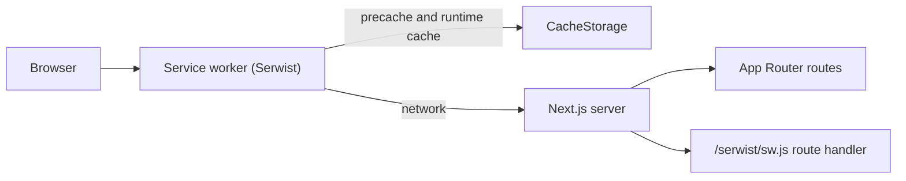
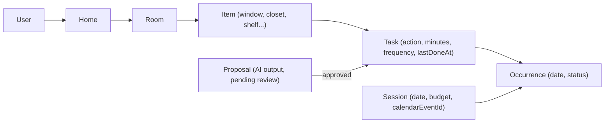
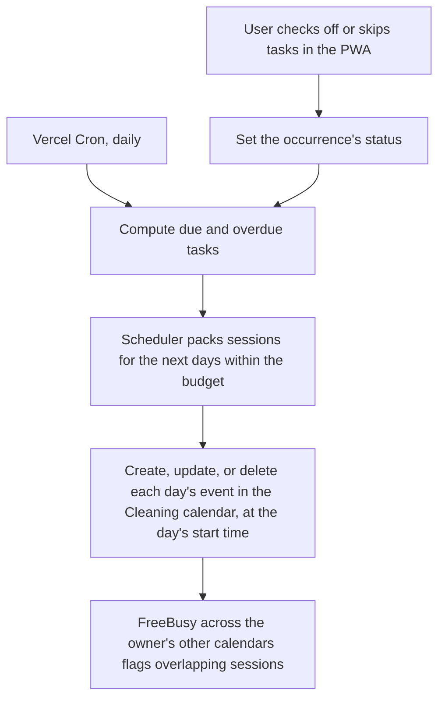

# Architecture

## Overview

A single Next.js 16 App Router application, rendered with Cache Components and Partial Prefetching, installable as a PWA. It plans household cleaning: AI proposes tasks, a deterministic scheduler packs them into daily sessions, and the sessions are synced to Google Calendar.

## Rendering

- **Server Components by default.** Client Components only where interactivity is needed.
- **Cache Components** (`cacheComponents: true`): static shell + dynamic holes behind `<Suspense>`. Use `"use cache"` for cacheable data. Route segment config (`dynamic`, `revalidate`) is not allowed.
- **Partial Prefetching**: `<Link>` prefetches the static shell of a route so it can render instantly, even offline.

## PWA and offline

| Concern                          | Where                                                                                   |
| -------------------------------- | --------------------------------------------------------------------------------------- |
| Manifest                         | `src/app/manifest.ts` (served at `/manifest.webmanifest`)                               |
| Icons                            | `public/icons/`                                                                         |
| Service worker source            | `src/app/sw.ts`                                                                         |
| Service worker build and serving | `src/app/serwist/[path]/route.ts` (esbuild at request time, served at `/serwist/sw.js`) |
| Registration                     | `SerwistProvider` in `src/app/layout.tsx`                                               |
| Offline document fallback        | `src/app/~offline/page.tsx` (precached)                                                 |
| In-app connectivity state        | `experimental.useOffline` + `useIsOffline()` in `src/hooks/use-is-offline.ts`           |
| Offline inventory reading        | [ADR 0005](decisions/0005-offline-inventory-reading.md)                                 |

There are three layers of offline behavior:

1. **Inside a running app**: Next's `useOffline` keeps failed soft navigations and Server Actions pending and retries them when the connection returns. `useIsOffline()` adds `navigator.onLine`, so a page loaded from the cache while offline also knows it is offline. The offline banner tells the user.
2. **Cold loads without network**: the service worker serves precached assets and runtime-cached pages; uncached documents get the `/~offline` fallback.
3. **Inventory** (`/rooms`): read-only offline. Inventory RSC payloads are not cached, because their cache keys depend on the router state and go stale. Instead, `OfflineCacheWarmer` refreshes the cached documents whenever the data changes online, and `OfflineAwareLink` does full page loads while offline. Task pages (`/tasks`, `/tasks/review`, `/home-profile`) and `/settings` follow the same pattern (ADR 0005 amendment). Edit controls are disabled offline (`useEditsDisabled()`), so no Server Action is ever queued.
4. **Today** (`/`) and **Earlier days** (`/earlier-days`): the only pages that accept changes offline. Check-offs go to a device queue and are sent when the connection returns (ADR 0008).

## UI

- Tailwind CSS v4 with CSS variables defined in `src/app/globals.css` (light and `.dark`).
- shadcn/ui components in `src/components/ui/` (Base UI primitives).
- Theme via `next-themes` (`class` strategy, system default).
- Layout shell in `src/components/app-shell.tsx`, which handles safe-area insets for standalone mode.
- Navigation (spec 010): `AppNav` in `src/components/app-nav.tsx` shows the destinations in `src/lib/navigation.ts` (Today, Plan, Tasks, Rooms, Settings) as a bottom tab bar below `sm` and as top-bar links from `sm` up, marking the current section. `/settings` groups the schedule, the Google Calendar connection (`/schedule#calendar`), and the home profile, with one-line summaries from `src/lib/settings/summary.ts`.
- Every clickable control gets a pointer cursor from a base rule in `globals.css`, since Tailwind v4 resets buttons to the default cursor.

## Domain model

Terms are defined in the glossary in [`PRODUCT.md`](PRODUCT.md#glossary).

- Every user-owned record carries a `userId`, so sharing can be added later.
- **Home is implicit for now**: with one home per user, the user is the home. A `home` table can be added with sharing without moving data.

### Inventory (spec 002)

| Concern    | Where                             | Notes                                                                                                                    |
| ---------- | --------------------------------- | ------------------------------------------------------------------------------------------------------------------------ |
| Tables     | `src/db/schema/inventory.ts`      | `room` (unique `(user_id, lower(name))`) and `item` (`type`, `name`, `count`, `note`), cascade-deleted with their owner. |
| Item types | `src/lib/inventory/item-types.ts` | A fixed list with labels and icons. Stored as `text` and validated in code, so adding a type needs no migration.         |
| Validation | `src/lib/inventory/schemas.ts`    | Zod schemas shared by forms and actions; duplicate room names map to a field error.                                      |
| Reads      | `src/lib/inventory/queries.ts`    | Getters resolve the user, then call `"use cache"` functions keyed by `userId` and tagged `inventory:<userId>`.           |
| Writes     | `src/app/(app)/rooms/actions.ts`  | Server Actions scope every query by `userId`, return typed results, and call `updateTag` on the user's inventory tag.    |
| UI         | `src/components/inventory/`       | Forms use a sheet on mobile and a dialog on desktop (`src/components/responsive-dialog.tsx`).                            |

### Tasks and AI proposals (spec 003)

| Concern      | Where                                           | Notes                                                                                                                                                                                             |
| ------------ | ----------------------------------------------- | ------------------------------------------------------------------------------------------------------------------------------------------------------------------------------------------------- |
| Tables       | `src/db/schema/tasks.ts`                        | `home_profile` (helpers, note), `task_proposal` (pending, with the `scope_room_id` it was generated for), and `task`. A task targets an item, a room, or the whole home.                          |
| Domain rules | `src/lib/tasks/`                                | Limits, helper list, per-type cleaning guide, Zod schemas, and formatting. The cleaning guide and helper guidance are the prompt's domain knowledge.                                              |
| AI           | `src/lib/ai/`                                   | `proposeTasks` builds the prompt from the inventory, profile, and existing tasks, calls Gemini with a Zod output schema, then validates and dedupes.                                              |
| Reads        | `src/lib/tasks/queries.ts`                      | Cached per user and tagged with both the tasks and the inventory tags.                                                                                                                            |
| Writes       | `src/app/(app)/tasks/actions.ts`                | Generating adds proposals only for rooms and items with no tasks and no pending proposals (spec 008); nothing is replaced. Accepting moves proposals into `task`; nothing is accepted by default. |
| UI           | `src/components/tasks/`, `src/app/(app)/tasks/` | Review screen (`/tasks/review`), task list (`/tasks`), and home profile (`/home-profile`). All three stay readable offline (ADR 0005).                                                            |

Proposal flow: the user picks a scope (whole home or one room) and asks for proposals. The server reads the inventory, home profile, existing tasks, and every pending proposal. Only rooms, items, and home-wide routines with no tasks and no pending proposals go to the AI (`src/lib/tasks/coverage.ts`, spec 008); the rest is listed as already planned, and output aimed at a covered target is dropped. When nothing is new, the review page says so and no request is made. Gemini returns structured proposals with references (`r1`, `r1.i1`, `home`) that the code maps back to rows and rejects if invalid. A failure, timeout, or invalid output saves nothing. With `AI_FAKE=1`, a deterministic fake (`src/lib/ai/fake-proposals.ts`) replaces Gemini for e2e and CI.
- **Due date = `lastDoneAt` + frequency.** A task's schedule moves with actual completion rather than following a fixed recurrence.
- **Priority = overdue ratio** (days past due divided by frequency), so a weekly task 3 days late outranks a monthly task 3 days late.

### Scheduler (spec 004)

See [ADR 0007](decisions/0007-persisted-plan-and-replanning.md).

| Concern   | Where                                                                    | Notes                                                                                                                                                                                                                                              |
| --------- | ------------------------------------------------------------------------ | -------------------------------------------------------------------------------------------------------------------------------------------------------------------------------------------------------------------------------------------------- |
| Tables    | `src/db/schema/schedule.ts`                                              | `schedule_settings` (a start time per weekday or null for off, weekday and weekend budgets, time zone, `planned_through`, `replanned_on`) and `occurrence` (task and date, unique together, with a status).                                        |
| Algorithm | `src/lib/scheduler/schedule.ts`                                          | Pure and deterministic, in whole-day numbers. Packs must-do work by overdue ratio, pulls work forward when a coming day would overflow, and staggers new tasks.                                                                                    |
| Replans   | `src/lib/scheduler/plan.ts`, `replan-start.ts`                           | `replan` after task, inventory, or settings changes; `ensurePlan` when the plan or Today page is read (a full replan on a new day, otherwise the missing days). Both lock the settings row and only replace scheduled days from the start date on. |
| Reads     | `src/lib/scheduler/queries.ts`                                           | Settings are cached per user (`schedule:<userId>`). The week is read uncached after `io()`, since it depends on the date.                                                                                                                          |
| UI        | `src/app/(app)/plan/`, `src/app/(app)/schedule/`, `src/components/plan/` | Weekly plan (`/plan`) and settings (`/schedule`). Both stay readable offline (ADR 0005).                                                                                                                                                           |

A task's last completion is its latest done or skipped occurrence before the replanning date; a task that was planned but never handled is due on its first missed day, and a new task keeps the first due day the scheduler picked (`task.first_due`). See [ADR 0008](decisions/0008-check-off-and-offline-queue.md).

Each occurrence stores the minutes it was planned with (`planned_minutes`), and Today, the plan, and calendar events read them, so a day that has started keeps its minutes and slots when an estimate changes. Estimates calibrate themselves from recorded times (spec 011): once a cleaning task has 3 times since its minutes were last set by hand (`task.minutes_set_at`), `calibrateTask` (`src/lib/tasks/calibrate.ts`, rule in `calibration.ts`) sets them to the median of the last 5 and replans. See [ADR 0009](decisions/0009-time-calibration.md).

### Today and habit (specs 006, 009, 013)

| Concern   | Where                                                  | Notes                                                                                                                                                                                     |
| --------- | ------------------------------------------------------ | ----------------------------------------------------------------------------------------------------------------------------------------------------------------------------------------- |
| Rules     | `src/lib/today/progress.ts`, `streak.ts`               | Pure: progress leaves skipped tasks out; a cleaning day is complete when all its tasks are done or skipped and at least one is done.                                                      |
| Order     | `src/lib/today/order.ts`, `slots.ts`                   | Pure: cleaning tasks by room, then zone (high, other, wet, floors, the room itself), then item; whole-home tasks last. Slots run back to back from the start time on estimates.           |
| Reads     | `src/lib/today/queries.ts`, `earlier.ts`               | Today's occurrences with status and actual minutes, in the recommended order, and per-day cleaning counts for the streak; the last 7 days grouped by day; uncached after `io()`.          |
| Check-off | `src/app/(app)/actions.ts`, `src/lib/today/schemas.ts` | `setOccurrenceStatus` sets a status, and optionally the minutes a done cleaning task took, on an occurrence from today or the 7 days before; it replans after past days and calibrations. |
| Offline   | `src/lib/today/queue.ts`, `src/components/today/`      | A `localStorage` queue per user, flushed in order on load, `online`, and visibility, one page at a time. `useCheckOffs` overlays queued states and minutes on the server's.               |
| UI        | `src/app/(app)/page.tsx`, `earlier-days/page.tsx`      | The home page (`/`) and Earlier days (`/earlier-days`). Readable and checkable offline (ADR 0005 amendment, ADR 0008).                                                                    |

### Google Calendar sync (spec 005)

See [ADR 0002](decisions/0002-google-calendar.md) and [`DEPLOYMENT.md`](DEPLOYMENT.md).

| Concern   | Where                                                                           | Notes                                                                                                                                                                                                                                                                                                                        |
| --------- | ------------------------------------------------------------------------------- | ---------------------------------------------------------------------------------------------------------------------------------------------------------------------------------------------------------------------------------------------------------------------------------------------------------------------------- |
| Tables    | `src/db/schema/calendar.ts`                                                     | `calendar_connection` (one row per connected owner: calendar id and name, status `ok`, `reauth`, or `error`, last sync) and `calendar_day` (event id, content digest, and overlap per date).                                                                                                                                 |
| Consent   | `src/components/calendar/connect-button.tsx`, `src/app/api/calendar/connected/` | Better Auth `linkSocial` adds the calendar scopes and a refresh token to the Google account; the route checks the scopes, creates the connection, and runs the first sync.                                                                                                                                                   |
| Google    | `src/lib/calendar/google.ts`, `client.ts`, `fake.ts`                            | REST over `fetch`; errors are `auth`, `gone`, `conflict`, or `transient`. Better Auth's `getAccessToken` refreshes tokens. `CALENDAR_FAKE=1` swaps in an in-memory calendar for e2e and CI.                                                                                                                                  |
| Sync      | `src/lib/calendar/sync.ts`, `diff.ts`, `events.ts`, `overlap.ts`                | Builds one event per cleaning day, lasting the day's budget (spec 007), from the first replannable day through the seventh; writes only changed digests, deletes days that lost their cleaning, and flags overlaps of the whole block from free/busy. "Sync now" forces a rewrite of every day from today, ignoring digests. |
| When      | `scheduleCalendarSync` in `plan.ts` and the schedule action                     | After every replan, via `after()`; on connect; in the daily job; and awaited on "Sync now". A row lock runs one sync per owner at a time. Failures set the status and never reach the caller.                                                                                                                                |
| Daily job | `src/app/api/cron/daily/`, `vercel.json`                                        | Vercel Cron, once a day, `Authorization: Bearer $CRON_SECRET`. Extends each connected owner's plan, then syncs, one owner at a time.                                                                                                                                                                                         |
| UI        | `src/components/calendar/`, `src/components/plan/plan-day.tsx`                  | "Google Calendar" section on `/schedule` with the last-synced time and "Sync now" (replans, then forces a sync, spec 007), overlap line on plan days, and a sync-error notice on both pages. Disconnect deletes the calendar and revokes the grant.                                                                          |

Event ids derive from the user and the date (base32hex), so writing a day again updates the same event and a lost row can't duplicate it. A deleted "Cleaning" calendar is created again on the next sync, with every day re-put.

## Responsibilities: AI vs code

| Concern                                   | Owner                                          | Why                                      |
| ----------------------------------------- | ---------------------------------------------- | ---------------------------------------- |
| Propose tasks, minutes, frequency, splits | Gemini (structured output, Zod-validated)      | Needs world knowledge about cleaning     |
| Approve or edit proposals                 | User                                           | Trust and control                        |
| Pack tasks into daily sessions, rebalance | Deterministic scheduler (`src/lib/scheduler/`) | Predictable, testable, free, explainable |
| Flag sessions that overlap busy times     | Calendar sync via FreeBusy                     | Respects the user's real availability    |

## Daily flow

- The scheduler plans a rolling 7-day horizon and replans from today on the first visit of each day (and in the daily job), so missed work is redistributed automatically without exceeding the daily budget.
- Calendar writes are idempotent: each day's event id is derived from the owner and the date, and only days whose content digest changed are written. Each event lasts the day's budget, so a budget change rewrites the coming days in place. "Sync now" forces a rewrite of every day from today through the seventh, whatever the digests.

## Data, auth, and integrations

See ADRs [0002](decisions/0002-google-calendar.md), [0003](decisions/0003-ai-provider-gemini.md), and [0004](decisions/0004-data-auth-hosting.md). In short:

- **Database:** Postgres (Neon), accessed through Drizzle over a `pg` pool (`src/db/index.ts`). The schema lives in `src/db/schema/` and migrations in `drizzle/`. Environment variables are validated in `src/lib/env.ts`.
- **Auth:** Better Auth with Google sign-in (`src/lib/auth.ts`, mounted at `/api/auth/*`), restricted to an email allowlist. Connecting Google Calendar adds the calendar scopes and a refresh token to the same account row.
- **AI:** Gemini through the Vercel AI SDK, server-only. Prompts and schemas live in `src/lib/ai/`.
- **Calendar:** Google Calendar API with the `calendar.app.created`, `calendar.calendarlist.readonly`, and `calendar.freebusy` scopes. The app writes only to its own calendar and reads only busy times from the others.
- **Hosting:** Vercel, with Vercel Cron for the daily job (`/api/cron/daily`). Setup steps are in [`DEPLOYMENT.md`](DEPLOYMENT.md).

### Route protection

| Layer             | Where                             | What it does                                                                                                                                 |
| ----------------- | --------------------------------- | -------------------------------------------------------------------------------------------------------------------------------------------- |
| Optimistic check  | `src/proxy.ts`                    | Redirects requests without a session cookie to `/sign-in?callbackURL=...`. It does not validate the cookie.                                  |
| Data access layer | `src/lib/session.ts`              | `getCurrentUser()` validates the session (`"use cache: private"`) and redirects when it is missing. Every protected page and action uses it. |
| Route groups      | `src/app/(app)`, `(public)`       | `(app)` renders the app shell and account menu; `(public)` holds `/sign-in` and `/~offline` with a minimal layout.                           |
| Sign-out          | `src/components/account-menu.tsx` | Ends the session, deletes the service worker's runtime caches, and replaces the history entry, so cached pages can't show signed-in content. |

## Testing

- Unit and component tests: Vitest + Testing Library + jsdom, colocated as `*.test.ts(x)`.
- End-to-end: Playwright against a production build on desktop and mobile (Pixel 7) projects. Covers the manifest, service worker registration, offline fallback, auth flows, the inventory (including offline reading and data isolation between owners), tasks, the plan, and Today and earlier days (including offline check-off). `E2E_PORT` overrides the server port so several checkouts can run the suite at once.
- E2E needs a Postgres database (`DATABASE_URL`). The `signedInUser` fixture in `e2e/fixtures.ts` creates a user and session cookies through a test-only auth instance, so tests never go through Google. CI runs a Postgres service container.
