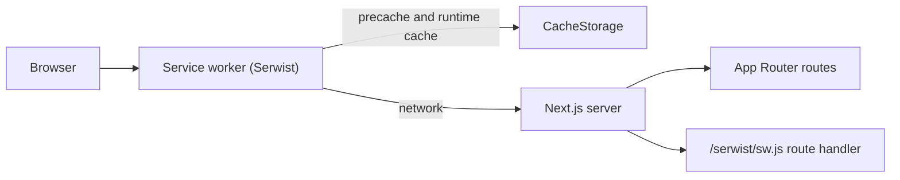

# Architecture

## Overview

A single Next.js 16 App Router application, rendered with Cache Components and Partial Prefetching, installable as a PWA.

## Rendering

- **Server Components by default.** Client Components only where interactivity is needed.
- **Cache Components** (`cacheComponents: true`): static shell + dynamic holes behind `<Suspense>`. Use `"use cache"` for cacheable data. Route segment config (`dynamic`, `revalidate`) is not allowed.
- **Partial Prefetching**: `<Link>` prefetches the static shell of a route so it can render instantly, even offline.

## PWA and offline

| Concern                          | Where                                                                                   |
| -------------------------------- | --------------------------------------------------------------------------------------- |
| Manifest                         | `src/app/manifest.ts` (served at `/manifest.webmanifest`)                               |
| Icons                            | `public/icons/`                                                                         |
| Service worker source            | `src/app/sw.ts`                                                                         |
| Service worker build and serving | `src/app/serwist/[path]/route.ts` (esbuild at request time, served at `/serwist/sw.js`) |
| Registration                     | `SerwistProvider` in `src/app/layout.tsx`                                               |
| Offline document fallback        | `src/app/~offline/page.tsx` (precached)                                                 |
| In-app connectivity state        | `experimental.useOffline` + `useOffline()` in `src/components/offline-banner.tsx`       |

There are two layers of offline behavior:

1. **Inside a running app**: Next's `useOffline` keeps failed soft navigations and Server Actions pending and retries them when the connection returns. The offline banner tells the user.
2. **Cold loads without network**: the service worker serves precached assets and runtime-cached pages; uncached documents get the `/~offline` fallback.

## UI

- Tailwind CSS v4 with CSS variables defined in `src/app/globals.css` (light and `.dark`).
- shadcn/ui components in `src/components/ui/` (Base UI primitives).
- Theme via `next-themes` (`class` strategy, system default).
- Layout shell in `src/components/app-shell.tsx`, which handles safe-area insets for standalone mode.

## Data

_Not decided yet. Record the choice (database, auth, sync strategy) as an ADR when the product is defined._

## Testing

- Unit and component tests: Vitest + Testing Library + jsdom, colocated as `*.test.ts(x)`.
- End-to-end: Playwright against a production build on desktop and mobile (Pixel 7) projects. Covers the manifest, service worker registration, and offline fallback.
